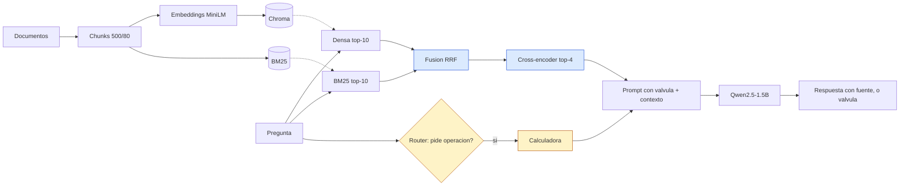

# M3 · RAG agéntico sobre el sistema de riesgo crediticio

**Qué hace.** Responde preguntas sobre la documentación de nuestro propio proyecto de riesgo
crediticio. Busca los pasajes que sirven, hace la cuenta si la pregunta pide una operación, y
avisa cuando no sabe en lugar de inventar. Lo pensamos para alguien del equipo que necesita
consultar algo puntual sin ponerse a leer los notebooks: qué significa una variable, por qué
sacamos otra del modelo, qué umbral estamos usando. Para nosotros una buena respuesta es la que
contesta lo que se preguntó, sale de un documento del corpus y dice de cuál.

Equipo: Jaider España, Camila Martínez

## Pipeline

En azul las dos técnicas avanzadas, en amarillo la capa agéntica.

## Corpus e índice

Son 8 documentos, 8.172 caracteres, que quedan en 23 chunks. Los escribimos nosotros a partir de
lo que hicimos en M1 y M2: diccionario de datos, limpieza, cómo definimos la etiqueta, qué
variables sacamos, el modelo y su umbral, el problema del pooler, el harness con su rúbrica y la
auditoría de sesgos. Es material nuestro, de uso académico, y está en `m3_salida/corpus_m3.json`.

**Chunks de 500 con 80 de solapamiento.** Nuestros documentos son párrafos apretados donde una
definición completa ocupa dos o tres frases. Probamos con 400 y las definiciones quedaban partidas
por la mitad. Con 500 y ese solapamiento, cada definición alcanza a quedar entera en al menos un
chunk.

**Embeddings `paraphrase-multilingual-MiniLM-L12-v2`.** Es el mismo que usa la dimensión 1 del
harness de M2. Si usáramos otro para buscar, la métrica y el buscador estarían midiendo cosas
distintas y la comparación entre módulos no serviría.

**top-k = 4.** Varias preguntas necesitan dos documentos a la vez: el umbral está en uno y la razón
por la que cambió está en otro. Con k=3 se perdía el segundo. Con k=5 entraba ruido y el generador
se ponía a repetirlo.

## Qué le falla al RAG ingenuo

Antes de meter técnicas quisimos saber qué estaba fallando de verdad. Escogimos cinco consultas que
nos parecían difíciles y medimos en qué posición quedaba el chunk correcto. Nos llevamos una
sorpresa: tres de las cinco no fallaban.

| Consulta | Qué suponíamos | Posición con densa | Resultado |
| :-- | :-- | --: | :-- |
| ¿qué significa el centinela -999? | término exacto | 1 | no falla |
| ¿cuánto vale PR-AUC del modelo afinado? | término exacto | 1 | no falla |
| mi modelo da resultados distintos cada vez que lo cargo | consulta coloquial | >10 | falla |
| ¿por qué no se usa el sexo del solicitante? | top-k con ruido | 1 | no falla |
| ¿a quién perjudica más el modelo? | consulta abstracta | 4 | falla débil |

Las dos que sí fallaban nos marcaron qué poner. **Búsqueda híbrida BM25 + densa con RRF**, porque
en la consulta coloquial el embedding no encuentra el documento pero las palabras sí están ahí. Y
**reranking con cross-encoder**, para reordenar lo que llega: recuperamos 10 candidatos y pasamos
los 4 mejores. Esa era la hipótesis; en la ablación medimos cuál de las dos pagó de verdad. El
detalle por consulta está en `m3_salida/rangos_diagnostico.csv`.

## Tabla evolutiva

El eval set tiene 15 casos: 10 con la respuesta en el corpus, 3 que piden una operación y 2 cuya
respuesta no está. Todas las filas usan el mismo harness, el mismo eval set y el mismo prompt base.

| Sistema | D1 · similitud | D2 · juez v1.1 | D2 · juez M2 | D3 · aciertos | gold | válvula | doc recuperado | latencia |
| :-- | --: | --: | --: | --: | --: | --: | --: | --: |
| Línea base M2 (sin RAG) | 0,410 | 2,0 | 1,73 | 2/15 | 2/10 | 0/2 | — | 2,26 s |
| RAG ingenuo (S07) | 0,615 | 4,4 | 3,53 | 12/15 | 8/10 | 2/2 | 12/13 | 1,70 s |
| RAG avanzado | 0,645 | 4,2 | 2,93 | 12/15 | 9/10 | 2/2 | 13/13 | 1,36 s |
| Sistema final (router) | 0,651 | 4,2 | 2,93 | 12/15 | 9/10 | 2/2 | 13/13 | 1,77 s |

La dimensión 2 va en dos columnas y hay que explicar por qué. `juez M2` es la vara original tal
como quedó en el módulo pasado. El problema es que esa vara no pasa su propia prueba de cordura:
le pone la misma nota a un dictamen correcto y a uno con cifras inventadas. Así que agregamos
`juez v1.1`, que usa Qwen2.5-7B en 4 bits y sí la pasa, y es el que usamos para D3. Dejamos las dos
columnas y las aplicamos igual a las seis versiones, para que el delta entre filas siga siendo
comparable.

**Ablación**, quitando una técnica a la vez:

| Sistema | D2 · juez v1.1 | D3 | doc recuperado | latencia |
| :-- | --: | --: | --: | --: |
| RAG ingenuo | 4,4 | 12/15 | 12/13 | 1,70 s |
| + híbrida, sin rerank | 4,4 | 12/15 | 12/13 | 2,03 s |
| + rerank, sin BM25 | 4,0 | 12/15 | 13/13 | 1,85 s |
| Las dos juntas | 4,2 | 12/15 | 13/13 | 1,36 s |

## Capa agéntica

Armamos dos herramientas con su esquema: una calculadora y el retriever. Lo primero que intentamos
fue dejar que el generador decidiera solo cuándo llamarlas, y probamos tres formatos distintos. No
funcionó en ninguno. Nunca llamaba la calculadora cuando hacía falta, buscaba en el corpus sin
necesidad, y encima se abstenía en cuatro preguntas que el RAG avanzado sí respondía.

| Sistema | D3 | gold | casos de cálculo con tool | llamadas de más | latencia |
| :-- | --: | --: | --: | --: | --: |
| RAG avanzado | 12/15 | 9/10 | 0/3 | 0 | 1,36 s |
| Agente libre | 9/15 | 6/10 | 2/3 | 4 | 2,93 s |
| Sistema final (router) | 12/15 | 9/10 | 1/3 | 0 | 1,77 s |

Por eso en el sistema final separamos las dos cosas. Un router con reglas decide si la pregunta
pide una operación, y el generador solo propone la expresión, que es lo que sí hace bien. El router
acierta en los 15 casos y no llama de más. El parseo acepta tres formatos distintos, si la
calculadora devuelve error se le pasa al modelo para que corrija, y hay tope de 3 pasos.

Para ver cuándo se usa y cuándo no, probamos tres consultas por fuera del eval set
(`m3_salida/demos_agente.csv`). En "¿cuántas veces mayor es la falsa alarma de los informales?"
llama la calculadora y responde bien. En "¿cuántos meses le faltan para el horizonte?" no la llama,
aunque de todos modos acierta. Y en "¿qué modelo base usa el sistema?" no la llama, que es lo
correcto.

El retriever como herramienta lo sacamos del sistema final. El RAG avanzado ya recupera bien en 13
de 13, así que volver a buscar solo sumaba tiempo.

**Un sesgo que tenemos que declarar:** el router lo escribimos conociendo las preguntas del eval
set. Que acierte en todas no demuestra que vaya a generalizar.

## RAGAS

Lo calculamos a mano como en el lab de S10, con Qwen2.5-7B en 4 bits de juez y los mismos
embeddings para answer relevancy. Dejamos por fuera los casos que no están en el corpus.

| Sistema | faithfulness | context precision | context recall | answer relevancy |
| :-- | --: | --: | --: | --: |
| RAG ingenuo | 0,778 | 0,288 | 0,923 | 0,727 |
| Sistema final | 0,792 | 0,308 | 0,923 | 0,719 |

## Lectura honesta

**1. ¿Qué movió qué?**

Lo que más movió el número fue simplemente tener RAG. Sin recuperación el generador acierta 2 de 10
casos gold, porque contesta de memoria y se va por las ramas: en una pregunta sobre el horizonte de
la etiqueta respondió que "se refiere a su durabilidad o vida útil" y que se descartan clientes
"por deterioro físico". Está hablando de productos, no de personas pidiendo un crédito. Con el RAG
ingenuo pasa a 8 de 10.

Del ingenuo al avanzado ganamos un caso y D3 se queda igual en 12/15. Es poco, pero sabemos de
dónde viene: de las cinco fallas que habíamos supuesto, tres no existían. La única real era Q07,
la consulta coloquial sobre por qué el modelo da resultados distintos al recargarlo.

Y ahí la ablación nos dejó un resultado que no esperábamos: la que arregla Q07 es el reranker, no
BM25. Con búsqueda densa el documento del pooler no entra al top-4. Agregar BM25 con RRF tampoco lo
mete, y la razón es curiosa: BM25 solo lo pone de primero, pero al fusionarlo con una densa que lo
tiene fuera de los diez, RRF promedia los rangos y lo baja a la posición 8. La fusión empeoró lo
que BM25 ya tenía bien. El reranker sí lo rescata, con BM25 o sin él.

Lo que BM25 aporta es cuál chunk llega. Con reranker solo entra `doc6_c1`; con las dos técnicas
entra `doc6_c0`, que es el que trae la explicación completa, y además de primero. Por eso lo
dejamos. Pero si tuviéramos que quedarnos con una sola técnica sería el reranking: la híbrida sube
la similitud (0,688 contra 0,615) y la nota del juez M2 (3,67), y no recupera ningún documento que
el ingenuo no recuperara.

Hay dos movimientos que no tienen que ver con la búsqueda. El avanzado pierde T02 porque el
generador calcula mal: dice que entran 49 columnas cuando son 45, y eso pasa aunque haya recuperado
el documento correcto. Y la dimensión 2 baja de 4,4 a 4,2 por un solo caso, donde la respuesta trae
las dos cifras que se pedían más una tercera, y el juez la marcó como que no coincide con la
referencia.

**2. ¿Cuánto costó?**

BM25 agrega menos de un milisegundo y el reranker unos 34 ms. Comparado con una generación que
tarda entre 1,3 y 2 segundos, eso es nada. De hecho el avanzado terminó con menor latencia total
que el ingenuo, 1,36 s contra 1,70 s, pero no por ser más rápido sino porque sus respuestas
salieron más cortas.

El router sube la mediana a 1,77 s. Lo caro aparece solo cuando se activa: en los casos de cálculo
la respuesta se va hasta 4,6 s, porque hay que generar la expresión además de la respuesta. Y hoy
ese costo no nos está comprando ningún acierto. El agente libre, con 2,93 s y tres casos gold
menos, directamente no se justifica.

**3. ¿Qué falla queda y de qué tipo es?**

La recuperación ya no es el problema. El documento correcto llega en 13 de 13 casos, y el context
recall de RAGAS (0,923) coincide con esa medida en 25 de 26 comparaciones. El context precision sí
es bajo, 0,31, pero era de esperarse: casi todas las preguntas se responden con un solo documento y
nosotros entregamos cuatro chunks.

Lo que queda son fallas de generación, que es justo lo que uno esperaría viendo una faithfulness de
0,79 con un recall alto. Son dos. La primera es Q02: el chunk correcto llega de primero y aun así
las tres versiones responden "No tengo esa información en mis fuentes". Lo raro es que las dos
versiones de la ablación, con ese mismo chunk de primero pero otros tres alrededor, sí la
respondieron, así que parece depender de qué más entra al contexto. La segunda es la aritmética de
T01 y T02: en T01 el generador propuso `5.0 * 4.5` cuando la cuenta era `22.1 / 7.4`. Ninguna de
las dos se arregla con más técnicas de búsqueda. Eso va por el lado del prompt o de un generador
más grande.

**4. ¿Qué pasó con las preguntas cuya respuesta no está en el corpus?**

La válvula se activó en los dos casos, en todas las versiones con RAG, incluido el agente libre.
Ninguna se inventó una cifra.

La línea base aparece con 0/2, pero cuando fuimos a mirar qué había contestado resulta que tampoco
inventó nada. En A01 dijo que no tenía información suficiente y pidió que le precisaran el tipo de
crédito, y en A02 que no tenía el dato y que eso había que consultarlo con la empresa. O sea que se
abstuvo bien, solo que con sus propias palabras. Nuestro criterio busca la frase literal "no tengo
esa información", así que igual la cuenta como fallo. Esa es una limitación de cómo medimos, no del
sistema.

Y hay que leer todo esto junto con Q02: la misma válvula que nos sirve en A01 y A02 es la que nos
está negando una respuesta que sí estaba en los documentos.

## Limitaciones

El eval set tiene 15 casos y las referencias las escribimos los mismos que construimos el sistema,
así que hay sesgo ahí. El corpus son 8 documentos propios; si metiéramos normativa externa la
búsqueda tendría una prueba más dura. Y el juez v1.1, aunque pasa la prueba de cordura, todavía se
equivoca en casos puntuales como el de Q06.

## Reproducibilidad

Semilla 42 y decodificación greedy. El notebook corre de principio a fin en Colab con GPU T4, sin
claves de pago, y las celdas quedan numeradas de 1 a 29 en una sola sesión. La primera corrida se
demora porque descarga unos 15 GB de pesos del juez. Las versiones exactas de todo están en
`m3_salida/versiones.json`.

Modelos: Qwen2.5-1.5B-Instruct de generador, Qwen2.5-7B-Instruct en 4 bits de juez,
paraphrase-multilingual-MiniLM-L12-v2 para embeddings y mmarco-mMiniLMv2-L12-H384-v1 de reranker.

## Uso de IA

Usamos Claude durante todo el proyecto. Lo contamos completo porque fue bastante.

**Código.** Partimos de los notebooks de clase (S05, S06, S07 y S10) como base. Claude nos ayudó a
adaptarlos a nuestro dominio y a extenderlos: el criterio de dominio del harness, los experimentos
de sesgo del juez, la auditoría por grupos y el pipeline de indexación de M3. También lo usamos
para depurar, y varios errores los encontró él revisando el código. Una expresión regular que se
comía el punto final de la frase, y por eso dos señales nunca se citaban en los dictámenes. Una
variable que se usaba antes de existir y rompía una celda. Y un caso sin proteger en la función de
auditoría que habría tumbado la corrida justo al final.

**Entender qué estaba pasando.** El problema del pooler lo encontramos preguntándole por qué el
modelo recargado no daba las métricas de M1. Nos explicó la causa y nos propuso dos salidas.
Elegimos la de probar doce semillas y documentar la dispersión, en vez de reconstruir la capa con
un ajuste por gradientes, porque queríamos una solución que pudiéramos explicar con lo visto en
clase.

**Redacción.** Los README y los textos de los notebooks los escribimos con su apoyo, a partir de
los números de nuestras corridas, y los revisamos antes de dejarlos.

**Lo que decidimos nosotros.** El corpus y las preguntas del eval set. Subir el juez de M3 a
Qwen2.5-7B y las tres correcciones de la rúbrica v1.1, después de ver que el de 1.5B contestaba lo
mismo a las cuatro preguntas binarias. Botar el agente libre tras tres intentos con formatos
distintos y poner el router en su lugar, dejando dicho que lo escribimos conociendo el eval set.
Qué medir en cada ablación. Y no reportar la calibración humana de M2: no la hicimos, y cuando se
planteó generar esas notas con la herramienta decidimos que un kappa entre dos modelos no mide lo
que dice medir.

Las corridas las hicimos nosotros y los números de los informes salen de ahí.